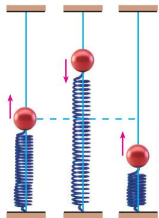
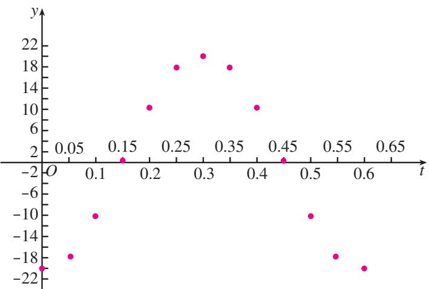
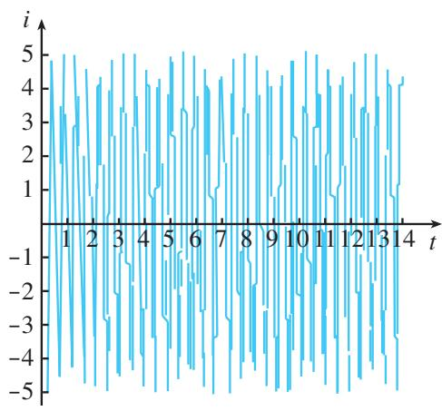
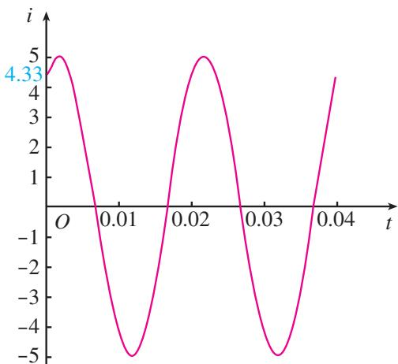

# 5.7 三角函数的应用·本节导语

现实生活中存在大量具有周而复始、循环往复特点的周期运动变化现象，如果某种变化着的现象具有周期性，那么就可以考虑借助三角函数来描述。本节通过几个具体实例，说明三角函数模型的简单应用。

问题1 某个弹簧振子（简称振子）在完成一次全振动的过程中，时间 $t$ （单位：s）与位移 $y$ （单位：mm）之间的对应数据如表5.7-1所示．试根据这些数据确定这个振子的位移关于时间的函数解析式.

表5.7-1

<table><tr><td>t</td><td>0.00</td><td>0.05</td><td>0.10</td><td>0.15</td><td>0.20</td><td>0.25</td><td>0.30</td><td>0.35</td><td>0.40</td><td>0.45</td><td>0.50</td><td>0.55</td><td>0.60</td></tr><tr><td>y</td><td>-20.0</td><td>-17.8</td><td>-10.1</td><td>0.1</td><td>10.3</td><td>17.7</td><td>20.0</td><td>17.7</td><td>10.3</td><td>0.1</td><td>-10.1</td><td>-17.8</td><td>-20.0</td></tr></table>

振子的振动具有循环往复的特点，由振子振动的物理学原理可知，其位移 y 随时间 t 的变化规律可以用函数 $y = A \sin(\omega t + \varphi)$ 来刻画.

● ●

根据已知数据作出散点图，如图 5.7-1 所示.

请你查阅资料，了解振子的运动原理.

  
图5.7-1

由数据表和散点图可知，振子振动时位移的最大值为 20 mm，因此 A=20；振子振动的周期为 0.6 s，即 $\frac{2\pi}{\omega}=0.6$ ，解得 $\omega=\frac{10\pi}{3}$ ；再由初始状态（t=0）振子的位移为 -20，得 $\sin \varphi = -1$ ，可取 $\varphi = -\frac{\pi}{2}$ 所以振子位移关于时间的函数解析式为

$$
y = 2 0 \sin \left(\frac {1 0 \pi}{3} t - \frac {\pi}{2}\right), t \in [ 0, + \infty).
$$

现实生活中存在大量类似弹簧振子的运动，如钟摆的摆动，水中浮标的上下浮动，琴弦的振动，等等．这些都是物体在某一中心位置附近循环往复的运动．在物理学中，把物体受到的力（总是指向平衡位置）正比于它离开平衡位置的距离的运动称为“简谐运动”.可以证明，在适当的直角坐标系下，简谐运动可以用函数 $y = A \sin (\omega x + \varphi)$ ， $x \in [0, +\infty)$ 表示，其中 $A > 0$ ， $\omega > 0$ ．描述简谐运动的物理量，如振幅、周期和频率等都与这个解析式中的常数有关：

A 就是这个简谐运动的振幅，它是做简谐运动的物体离开平衡位置的最大距离；

这个简谐运动的周期是 $T = \frac{2\pi}{\omega}$ ，它是做简谐运动的物体往复运动一次所需要的时间；

这个简谐运动的频率由公式 $f = \frac{1}{T} = \frac{\omega}{2\pi}$ 给出，它是做简谐运动的物体在单位时间内往复运动的次数；

$\omega x+\varphi$ 称为相位；x=0 时的相位 $\varphi$ 称为初相.

问题 2 图 5.7-2(1) 是某次实验测得的交变电流 i （单位：A）随时间 t （单位：s）变化的图象。将测得的图象放大，得到图 5.7-2(2)。

(1) 求电流 i 随时间 t 变化的函数解析式;

请你查阅资料，了解交变电流的产生原理.

(2) 当 $t = 0, \frac{1}{600}, \frac{1}{150}, \frac{7}{600}, \frac{1}{60}$ 时，求电流 $i$ .

  
(1)

  
图5.7-2  
(2)

由交变电流的产生原理可知，电流 $i$ 随时间 $t$ 的变化规律可用 $i = A\sin (\omega t + \varphi)$ 来刻画，其中 $\frac{\omega}{2\pi}$ 表示频率， $A$ 表示振幅， $\varphi$ 表示初相.

由图 5.7-2(2) 可知，电流最大值为 5 A，因此 A=5；电流变化的周期为 $\frac{1}{50}$ s，频率为 50 Hz，即 $\frac{\omega}{2\pi}=50$ ，解得 $\omega=100\pi$ ；再由初始状态（t=0）的电流约为 4.33 A，可得 $\sin \varphi=0.866$ ，因此 $\varphi$ 约为 $\frac{\pi}{3}$ 。所以电流 i 随时间 t 变化的函数解析式是

$$
i = 5 \sin \left(1 0 0 \pi t + \frac {\pi}{3}\right), t \in [ 0, + \infty).
$$

当 $t = 0$ 时， $i = \frac{5\sqrt{3}}{2}$ ；

当 $t = \frac{1}{600}$ 时， $i = 5$ ；

当 $t = \frac{1}{150}$ 时， $i = 0$ ；

当 $t = \frac{7}{600}$ 时， $i = -5$ ；

当 $t = \frac{1}{60}$ 时， $i = 0$ .

## 本节相关知识（范围关联）

- [三角函数模型的应用步骤](../%E7%9F%A5%E8%AF%86%E7%82%B9/%E4%B8%89%E8%A7%92%E5%87%BD%E6%95%B0%E6%A8%A1%E5%9E%8B%E7%9A%84%E5%BA%94%E7%94%A8%E6%AD%A5%E9%AA%A4--000088.md)

## 所属组织

- [5.7 三角函数的应用](../%E7%9F%A5%E8%AF%86%E4%B8%B2%E8%81%94/%E4%BA%BA%E6%95%99A-%E5%BF%85%E4%BF%AE%E7%AC%AC%E4%B8%80%E5%86%8C/%E6%95%99%E6%9D%90%E9%97%AE%E9%A2%98%E9%A1%BA%E5%BA%8F/%E7%AC%AC%E4%BA%94%E7%AB%A0%20%E4%B8%89%E8%A7%92%E5%87%BD%E6%95%B0/5.7%20%E4%B8%89%E8%A7%92%E5%87%BD%E6%95%B0%E7%9A%84%E5%BA%94%E7%94%A8/5.7%20%E4%B8%89%E8%A7%92%E5%87%BD%E6%95%B0%E7%9A%84%E5%BA%94%E7%94%A8.md)
