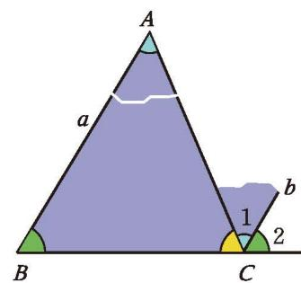

> [!question] 尝试·交流
> 我们知道，三角形三个内角的和等于 $180^{\circ}$ 。你还记得这个结论的探索过程吗？
>
> （1）如图 1-1，如果只把 $\angle A$ 移动到 $\angle 1$ 的位置，那么你能说明这个结论的正确性吗？如果不移动 $\angle A$ ，那么你还有什么方法可以达到同样的效果？
>
> 
> 图 1-1
>
> (2) 你能说说这个结论的证明思路吗? 请试着写出证明过程, 并与同伴进行交流。
