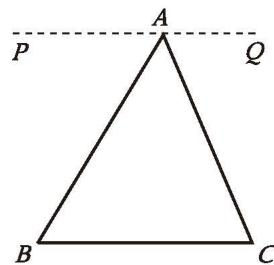

# 三角形内角和定理的其他证明方法思考

## 北师大版初中数学·八年级下册

> [!question] 思考·交流
> (1) 如图 1-4, 在证明三角形内角和定理时, 小明的想法是把三个内角 “凑” 到点 $A$ 处, 过点 $A$ 作直线 $PQ$ , 使 $PQ \parallel BC$ , 他的想法可行吗? 如果可行, 你能写出证明过程吗?
>
> (2) 对于三角形内角和定理, 你还有其他证明方法吗? 与同伴进行交流。
>
> 
> 图 1-4
>

