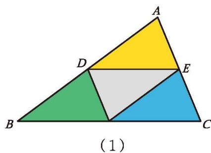
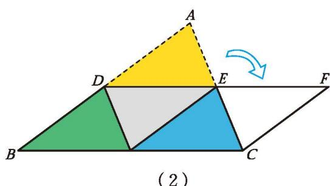

# 三角形剪拼与中位线性质猜想探究

## 北师大版初中数学·八年级下册

> [!question] 思考·交流
> 小明的做法是: 如图 6-19
> (1), 在 $\triangle ABC$ 中, 连接每两边的中点, 看上去就得到了四个全等的三角形。如图 6-19
> (2), 将 $\triangle ADE$ 绕点 $E$ 按顺时针方向旋转 $180^{\circ}$ 到 $\triangle CFE$ 的位置, 这样就得到了一个与 $\triangle ABC$ 面积相等的 $\square DBCF$ 。
>
> 
>
> 
> 图6-19
>
> 从小明的上述做法中，你能猜想出三角形两边中点的连线与第三边有怎样的关系吗？与同伴进行交流。

