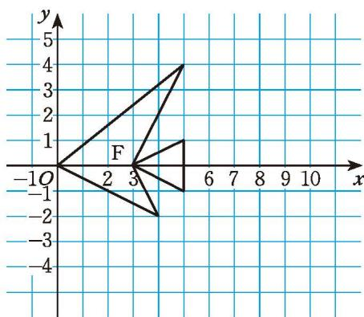

# 两次沿坐标轴平移等效于一次平移的探究

## 北师大版初中数学·八年级下册

将图 3-8 中的 “鱼” F 先向下平移 2 个单位长度，再向右平移 3 个单位长度，得到新 “鱼” F'。

（1）在图 3-8 所示的平面直角坐标系中画出 “鱼” F'。

(2)能否将“鱼”F'看成是由“鱼”F经过一次平移得到的？如果能，请指出平移的方向和平移的距离，并与同伴进行交流。

图3-8

(3) 在 “鱼” F 和 “鱼” F' 中, 对应点的坐标之间有什么关系?

改变 “鱼” F 最初的平移方向（仍沿坐标轴方向）和平移距离，再试一试，并与同伴进行交流。

