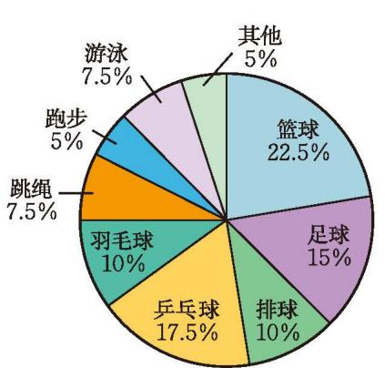
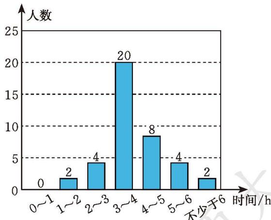

# 从全班体育活动问卷调查与条形图认识数据收集的方式

## 北师大版初中数学·七年级上册

为更好地了解全班同学参加体育活动的情况，体育委员小刚设计了一份简单的调查问卷，并对全班40名同学进行了调查。

1. 你最喜欢参加的体育活动项目是什么？（单选）
A. 篮球
B. 足球
C. 排球
D. 乒乓球
E. 羽毛球
F. 跳绳
G. 跑步
H. 游泳
I. 其他

2. 你每周参加体育活动的时间是多少?
A. 0\~1h
B. 1\~2h
C. 2\~3h
D. 3\~4h
E. 4\~5h
F. 5\~6h
G. 不少于6h

根据调查结果，小刚绘制出图 6-3 和图 6-4。

可以进行在线调查。

全班同学最喜欢参加的体育活动项目

图6-3

全班同学每周参加体育活动的时间

图6-4

(1) 该班学生最喜欢参加的体育活动项目排名前三的分别是什么?

(2)该班每周参加体育活动的时间不少于 $3 \mathrm{~h}$ 的学生有多少名?

