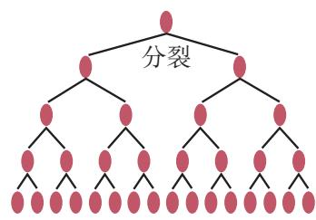

请看下面几个问题中的数列.

1. 两河流域发掘的古巴比伦时期的泥版上记录了下面的数列①：

$$
9, 9 ^ {2}, 9 ^ {3}, \dots , 9 ^ {1 0};\tag{①}
$$

$$
1 0 0, 1 0 0 ^ {2}, 1 0 0 ^ {3}, \dots , 1 0 0 ^ {1 0};\tag{②}
$$

$$
5, 5 ^ {2}, 5 ^ {3}, \dots , 5 ^ {1 0}.\tag{③}
$$

① 古巴比伦人用六十进制记数，这里转化为十进制.

2. 《庄子·天下》中提到：“一尺之棰，日取其半，万世不竭。”如果把“一尺之棰”的长度看成单位“1”，那么从第1天开始，各天得到的“棰”的长度依次是

$$
\frac {1}{2}, \frac {1}{4}, \frac {1}{8}, \frac {1}{1 6}, \frac {1}{3 2}, \dots .
$$

④

3. 在营养和生存空间没有限制的情况下，某种细菌每20 min就通过分裂繁殖一代，那么一个这种细菌从第1次分裂开始，各次分裂产生的后代个数依次是

$$
2, 4, 8, 1 6, 3 2, 6 4, \dots .\tag{⑤}
$$

4. 某人存入银行 $a$ 元，存期为5年，年利率为 $r$ ，那么按照复利②，他5年内每年末得到的本利和分别是

$$
a (1 + r), a (1 + r) ^ {2}, a (1 + r) ^ {3}, a (1 + r) ^ {4}, a (1 + r) ^ {5}.\tag{⑥}
$$

②复利是指把前一期的利息和本金加在一起算作本金，再计算下一期的利息.

探究

类比等差数列的研究，你认为可以通过怎样的运算发现以上数列的取值规律？你发现了什么规律？

我们可以通过除法运算探究以上数列的取值规律.

如果用 $\{a_{n}\}$ 表示数列①，那么有

$$
\frac {a _ {2}}{a _ {1}} = 9, \frac {a _ {3}}{a _ {2}} = 9, \dots , \frac {a _ {1 0}}{a _ {9}} = 9.
$$

这表明，数列①有这样的取值规律：从第2项起，每一项与它的前一项的比都等于9.

其余几个数列也有这样的取值规律，请你写出相应的规律.

思考

类比等差数列的概念，从上述几个数列的规律中，你能抽象出等比数列的概念吗？
