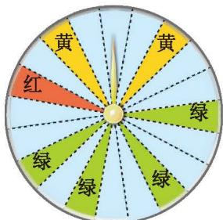

某商场为了吸引顾客，设立了一个可以自由转动的转盘，并将转盘等分成20个扇形，像图3-6那样涂上颜色。商场规定：顾客每购买100元商品，就能获得一次转动转盘的机会。如果转盘停止后，指针正好落在红色、黄色或绿色区域，顾客就可以分别获得100元、50元、20元的购物券。

图3-6

(1) 自由转动转盘, 当转盘停止时, 指针落在不同扇形的可能的结果共有多少种? 这些结果是等可能的吗?

(2) 某顾客购物消费 120 元, 获得一次转动转盘的机会。他获得 100 元、 50 元、20 元购物券的概率分别是多少? 他能获得购物券的 概率是多少?
