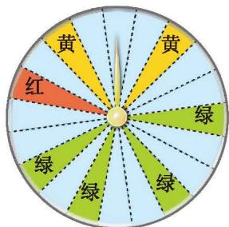

# 从商场三色转盘抽奖规则认识必然事件不可能事件与随机事件

## 北师大版初中数学·七年级下册

某商场进行促销活动，设立了一个可以自由转动的转盘（如图 3-1）。活动规则：

1. 顾客每购买 100 元商品，就能获得一次转动转盘的机会。

2. 自由转动转盘时，转盘要转 1 圈以上才算有效。

3. 如果当转盘停止时，指针正好落在红色、黄色、绿色区域，那么顾客就可以分别获得面额 100 元、50 元、20 元的购物券。

图3-1

张阿姨购物消费 110 元，获得一次转动转盘的机会。

(1) 她一定能获得购物券吗?

(2) 她能获得面额 10 元的购物券吗?

(3) 她获得的购物券一定不超过 100 元吗?

