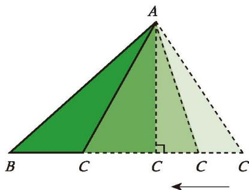

# 从固定高三角形顶点运动改变底边长与面积认识用关系式表示变量关系

## 北师大版初中数学·七年级下册

如图 6-3, $\triangle ABC$ 底边 $BC$ 上的高是 $6 \mathrm{~cm}$ 。当三角形的顶点 $C$ 沿底边所在直线向点 $B$ 运动时, 三角形的面积发生了变化。

(1) 在这个变化过程中, 自变量、因变量各是什么? 当底边长减小时, 三角形的面积是如何变化的?

图6-3

(2) 如果三角形的底边长为 $x$ (单位: $\mathrm{cm}$ ), 那么三角形的面积 $y$ (单位: $\mathrm{cm}^{2}$ ) 如何表示?

(3) 在这个变化过程中, 取定一个底边 $x$ 的值, 面积 $y$ 的值能确定吗? 与同伴进行交流。

