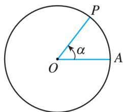

圆周运动是一种常见的周期性变化现象. 如图 5.1-1, $\odot O$ 上的点 $P$ 以 $A$ 为起点做逆时针方向的旋转. 如何刻画点 $P$ 的位置变化呢?

我们知道，角可以看成一条射线绕着它的端点旋转所成的图形。在图5.1-1中，射线的端点是圆心 $O$ ，它从起始位置 $OA$ 按逆时针方向旋转到终止位置 $OP$ ，形成一个角 $\alpha$ ，射线 $OA$ ， $OP$ 分别是角 $\alpha$ 的始边和终边。当角 $\alpha$ 确定时，终边 $OP$ 的位置就确定了。这时，射线 $OP$ 与 $\odot O$ 的交点 $P$ 也就确定了。由此想到，可以借助角 $\alpha$ 的大小变化刻画点 $P$ 的位置变化。

图5.1-1

由初中知识可知，射线 $OA$ 绕端点 $O$ 按逆时针方向旋转一周回到起始位置，在这个过程中可以得到 $0^{\circ} \sim 360^{\circ}$ 范围内的角。如果继续旋转，那么所得到的角就超出这个范围了。所以，为了借助角的大小变化刻画圆周运动，需要先扩大角的范围。
