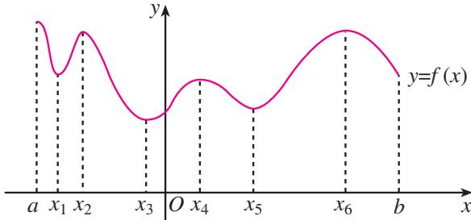
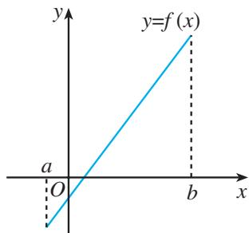
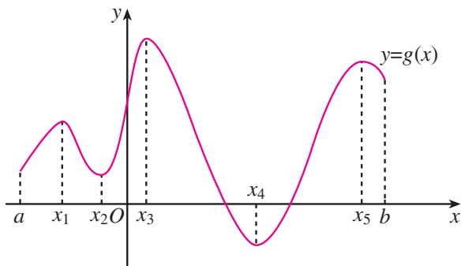

# 从局部极值走向闭区间上的最值

## 高中选择性必修 第二册·人教A版数学

我们知道，极值反映的是函数在某一点附近的局部性质，而不是函数在整个定义域内的性质。也就是说，如果 $x_0$ 是函数 $y = f(x)$ 的极大（小）值点，那么在 $x = x_0$ 附近找不到比 $f(x_0)$ 更大（小）的值。但是，在解决实际问题或研究函数的性质时，我们往往更关心函数在某个区间上，哪个值最大，哪个值最小。如果 $x_0$ 是某个区间上函数 $y = f(x)$ 的最大（小）值点，那么 $f(x_0)$ 不小（大）于函数 $y = f(x)$ 在此区间上的所有函数值。

图 5.3-13 是函数 $y=f(x)$ ， $x\in[a,b]$ 的图象，你能找出它的极小值、极大值吗？

  
图5.3-13

观察图象，我们发现， $f(x_{1})$ ， $f(x_{3})$ ， $f(x_{5})$ 是函数 $y=f(x)$ 的极小值， $f(x_{2})$ ， $f(x_{4})$ ， $f(x_{6})$ 是函数 $y=f(x)$ 的极大值.

第五章 一元函数的导数及其应用

探究

进一步地，你能找出函数 $y = f(x)$ 在区间 $[a, b]$ 上的最小值、最大值吗？

从图5.3-13可以看出，函数 $y = f(x)$ 在区间 $[a, b]$ 上的最小值是 $f(x_{3})$ ，最大值是 $f(a)$ .

在图5.3-14、图5.3-15中，观察 $[a, b]$ 上的函数 $y = f(x)$ 和 $y = g(x)$ 的图象，它们在 $[a, b]$ 上有最大值、最小值吗？如果有，最大值和最小值分别是什么？

  
图5.3-14

  
图5.3-15

