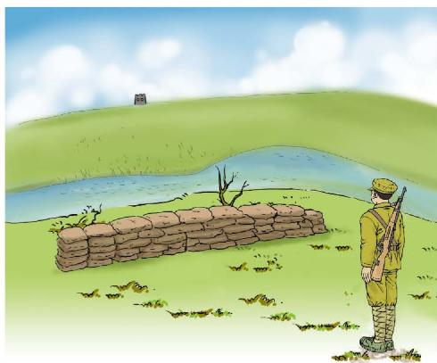
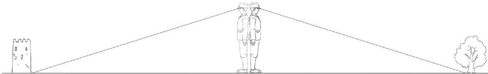

一位经历过战争的老人曾经讲述过这样一个故事：

图4-31

在一次战役中，我军阵地与敌军碉堡隔河相望（如图 4-31）。为了炸掉这个碉堡，需要知道碉堡与我军阵地的距离。在不能过河测量又没有任何测量工具的情况下，一名战士想出来这样一个办法：如图 4-32，他面向碉堡的方向站好，调整帽子，使视线通过帽檐正好落在碉堡的底部；然后，他转过一个角度，保持刚才的姿态，这时视线落在了自己所在岸的某一点上；接着，他用步测的方法量出自己与那个点的距离，这个距离就是他与碉堡间的距离。

图4-32

(1) 按这名战士的方法, 找出教室或操场上与你距离相等的两个点, 并通过测量加以验证。

(2) 你能解释其中的道理吗?
