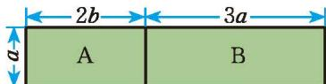

# 从操场两块长方形区域拼接面积与分配律引出单项式乘多项式

## 北师大版初中数学·七年级下册

（1）如图 1-4，在计算操场面积的问题中，如何计算 A 和 B 组成的长方形区域的面积？你是怎么计算的？

图1-4

(2) 小明认为, 这个长方形的面积既可以表示为 $a (2 b + 3 a)$ , 也可以表示为 $2 a b + 3 a^{2}$ , 于是 $a (2 b + 3 a) = 2 a b + 3 a^{2}$ 。你能用运算律解释吗?

