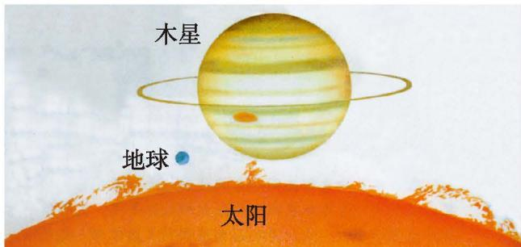

如图 1-1, 地球、木星、太阳可以近似地看成球体。木星、太阳的半径分别约为地球的 10 倍和 $10^{2}$ 倍, 它们的体积分别约为地球的多少倍?

图1-1

球的体积公式是 $V=\frac{4}{3}\pi r^{3}$ ，其中V是球的体积，r是球的半径。

木星的半径约为地球的 10 倍，它的体积约为地球的 $10^{3}$ 倍。

太阳的半径约为地球的 $10^{2}$ 倍，它的体积约为地球的 $(10^{2})^{3}$ 倍。那么，你知道 $(10^{2})^{3}$ 等于多少吗？
