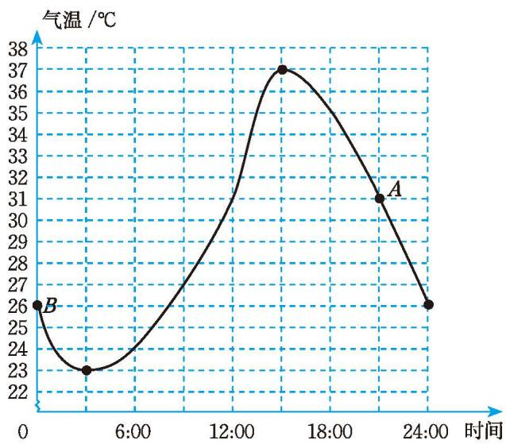

# 从某地一天气温变化曲线读图讨论认识用图象表示变量关系

## 北师大版初中数学·七年级下册

气温的变化是人们经常谈论的话题。请你根据图 6-6，与同伴讨论某地某天气温变化的情况。

(1) 你能描述该地这一天气温的变化情况吗? 在什么时间范围内气温下降, 什么时间范围内气温上升?

(2) 该地这一天的最低气温是多少, 是在何时达到的? 最高气温呢? 这一天的温差是多少?

(3) 图中的 $A$ 点表示什么? $B$ 点呢?

(4) 你预测该地这一天次日凌晨 $1:00$ 的气温是多少？说说你的理由。

图6-6

