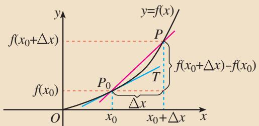

我们知道，导数 $f'(x_0)$ 表示函数 $y = f(x)$ 在 $x = x_0$ 处的瞬时变化率，反映了函数 $y = f(x)$ 在 $x = x_0$ 附近的变化情况。那么导数 $f'(x_0)$ 的几何意义是什么？

第五章 一元函数的导数及其应用

思考

观察函数 $y = f(x)$ 的图象（图5.1-3），平均变化率

$$
\frac {\Delta y}{\Delta x} = \frac {f (x _ {0} + \Delta x) - f (x _ {0})}{\Delta x}
$$

表示什么？瞬时变化率

$$
f ^ {\prime} \left(x _ {0}\right) = \lim _ {\Delta x \rightarrow 0} \frac {\Delta y}{\Delta x} = \lim _ {\Delta x \rightarrow 0} \frac {f \left(x _ {0} + \Delta x\right) - f \left(x _ {0}\right)}{\Delta x}
$$

  
图5.1-3

表示什么？
