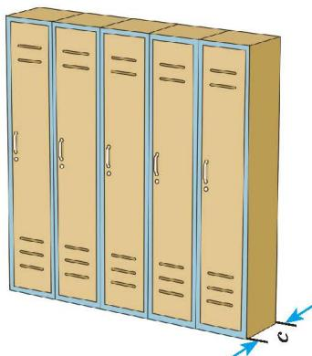
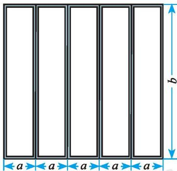

一个组合柜如图 3-2 所示，内部用隔板纵向分隔成 5 个独立的小柜子（如图 3-3），柜门由 5 个完全相同的长方形组成。

图3-2

图3-3

(1) 若要在 5 个柜门的周边都贴上装饰条, 则所需装饰条的总长度是多少?

(2) 若要给柜门外表面喷漆, 则需要喷漆的面积是多少 (边框缝隙忽略不计)?

(3) 设柜子的进深为 $c$ (如图 3-2), 则整个柜子的容积是多少 (柜门、隔板及背板的厚度忽略不计)?
