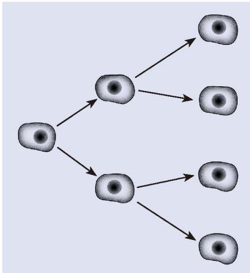

如图 2-11，某种细胞每过 30 min 便由 1 个分裂成 2 个。经过 5 h，这种细胞能由 1 个分裂成多少个？

1 个细胞经过 30 min 分裂成 2 个，经过 1 h 分裂成 $2 \times 2$ 个，经过 $\frac{3}{2}$ h 分裂成 $2 \times 2 \times 2$ 个……

经过 5h 分裂 10 次，分裂成

$$
\overbrace {2 \times 2 \times \cdots \times 2 \times 2} ^ {10 \text {个} 2} = 1024 (\text {个}) _ {\circ}
$$

图2-11

$$
\frac {10 \text {个} 2}{2 \times 2 \times \cdots \times 2 \times 2}
$$

为了简便，可将 $2\times2\times\cdots\times2\times2$ 记为 $2^{10}$ 。
