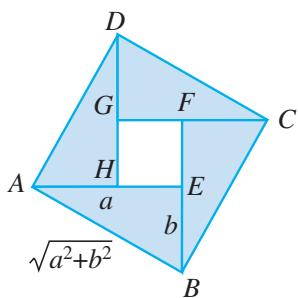

探究

图2.1-3是在北京召开的第24届国际数学家大会的会标，会标是根据中国古代数学家赵爽的弦图设计的，颜色的明暗使它看上去像一个风车，代表中国人民热情好客。你能在这个图中找出一些相等关系和不等关系吗？

  
图2.1-3

将图2.1-3中的“风车”抽象成图2.1-4. 在正方形ABCD中有4个全等的直角三角形．设直角三角形的两条直角边的长为 $a$ ， $b(a \neq b)$ ，那么正方形的边长为 $\sqrt{a^2 + b^2}$ ．这样，4个直角三角形的面积和为 $2ab$ ，正方形的面积为 $a^2 + b^2$ ．由于正方形ABCD的面积大于4个直角三角形的面积和，我们就得到了一个不等式

$$
a ^ {2} + b ^ {2} > 2 a b.
$$

  
图2.1-4

当直角三角形变为等腰直角三角形，即 a=b 时，正方形 EFGH 缩为一个点，这时有

$$
a ^ {2} + b ^ {2} = 2 a b.
$$

于是就有 $a^2 + b^2 \geqslant 2ab$ .

## 引出的知识

- [重要不等式](../%E7%9F%A5%E8%AF%86%E7%82%B9/%E7%9F%A5%E8%AF%86%E7%82%B9-%E9%87%8D%E8%A6%81%E4%B8%8D%E7%AD%89%E5%BC%8F.md)

## 本节相关知识（范围关联）

- [不等关系与实数大小比较的基本事实](../%E7%9F%A5%E8%AF%86%E7%82%B9/%E7%9F%A5%E8%AF%86%E7%82%B9-%E4%B8%8D%E7%AD%89%E5%85%B3%E7%B3%BB%E4%B8%8E%E5%AE%9E%E6%95%B0%E5%A4%A7%E5%B0%8F%E6%AF%94%E8%BE%83%E7%9A%84%E5%9F%BA%E6%9C%AC%E4%BA%8B%E5%AE%9E.md)
- [重要不等式](../%E7%9F%A5%E8%AF%86%E7%82%B9/%E7%9F%A5%E8%AF%86%E7%82%B9-%E9%87%8D%E8%A6%81%E4%B8%8D%E7%AD%89%E5%BC%8F.md)
