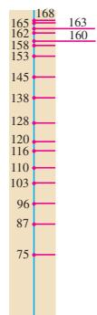

在现实生活和数学学习中，我们经常需要根据问题的意义，通过对一些数据按特定顺序排列的方法来刻画研究对象。例如：

1. 王芳从 1 岁到 17 岁，每年生日那天测量身高。将这些身高数据（单位：cm）依次排成一列数：

$$
\begin{array}{l} 7 5, 8 7, 9 6, 1 0 3, 1 1 0, 1 1 6, 1 2 0, 1 2 8, 1 3 8, \\ 1 4 5, 1 5 3, 1 5 8, 1 6 0, 1 6 2, 1 6 3, 1 6 5, 1 6 8. \end{array}\tag{①}
$$

记王芳第 i 岁时的身高为 $h_{i}$ ，那么 $h_{1}=75, h_{2}=87, \cdots, h_{17}=168$ 。我们发现， $h_{i}$ 中的 i 反映了身高按岁数从 1 到 17 的顺序排列时的确定位置，即 $h_{1}=75$ 是排在第 1 位的数， $h_{2}=87$ 是排在第 2 位的数…… $h_{17}=168$ 是排在第 17 位的数，它们之间不能交换位置。所以，①是具有确定顺序的一列数。

2. 在两河流域发掘的一块泥版（编号 K90，约产生于公元前 7 世纪）上，有一列依次表示 15 天中从第 1 天到第 15 天每天月亮可见部分的数 $^{①}$ ：

5, 10, 20, 40, 80, 96, 112, 128,
144, 160, 176, 192, 208, 224, 240. ②

记第 i 天月亮可见部分的数为 $s_{i}$ ，那么 $s_{1}=5,\quad s_{2}=10,\quad\cdots,\quad s_{15}=240$ 。这里， $s_{i}$ 中的 i 反映了月亮可见部分的数按日期从 1 到 15 的顺序排列时的确定位置，即 $s_{1}=5$ 是排在第 1 位的数， $s_{2}=10$ 是排在第 2 位的数…… $s_{15}=240$ 是排在第 15 位的数，它们之间不能交换位置。所以，②也是具有确定顺序的一列数。

① 把满月分成 240 份，则从初一到十五每天月亮的可见部分可用一个代表份数的数来表示.

3. $-\frac{1}{2}$ 的 n 次幂按 1 次幂、2 次幂、3 次幂、4 次幂……依次排成一列数：

$$
- \frac {1}{2}, \frac {1}{4}, - \frac {1}{8}, \frac {1}{1 6}, \dots .\tag{③}
$$

思考

你能仿照上面的叙述，说明③也是具有确定顺序的一列数吗？

上述例子的共同特征是什么？
