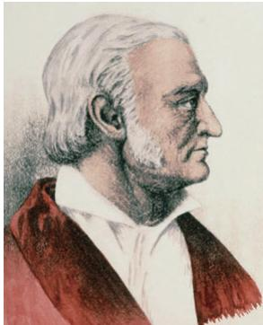

# 从高斯求和发现等差数列的对称性

## 高中选择性必修 第二册·人教A版数学

前面我们学习了等差数列的概念和通项公式，下面我们将利用这些知识解决等差数列的求和问题.

据说，二百多年前，高斯的算术老师提出了下面的问题：

$$
1 + 2 + 3 + \dots + 1 0 0 = ?
$$

当其他同学忙于把 100 个数逐项相加时，10 岁的高斯却用下面的方法迅速算出了正确答案：

$$
(1 + 1 0 0) + (2 + 9 9) + \dots + (5 0 + 5 1) = 1 0 1 \times 5 0 = 5 0 5 0.
$$

高斯的算法实际上解决了求等差数列

$$
1, 2, 3, \dots , n, \dots\tag{①}
$$

高斯(Gauss,1777—1855)，德国数学家，近代数学的奠基者之一．他在天文学、大地测量学、磁学、光学等领域都作出了杰出贡献.

前 100 项的和的问题.

思考

你能说说高斯在求和过程中利用了数列①的什么性质吗？你能从中得到求数列①的前 $n$ 项和的方法吗？

