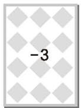
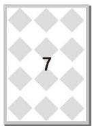
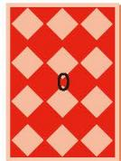
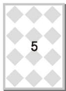
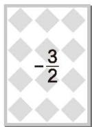
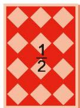
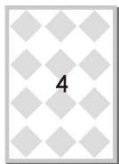
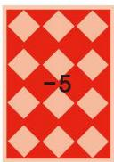

# 卡片加减游戏：有理数加减混合运算实践

## 北师大版初中数学·七年级上册

请按下列规则做游戏：

(1) 每人每次抽取 4 张卡片。若抽到白底卡片, 则加卡片上的数字; 若抽到红底卡片, 则减卡片上的数字。

(2) 比较两人所抽 4 张卡片的计算结果, 结果大的为胜者。

小丽抽到的 4 张卡片依次为:

她抽到的卡片的计算结果是多少? 小彬抽到的4张卡片依次为:

与同伴做一做这个游戏。

获胜的是谁?

