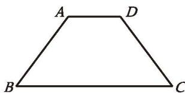
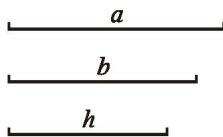

# 回顾反思：逐步确定策略的顺序选择、通用方法与同余拓展

## 北师大版初中数学·八年级上册

(1) 通过解决上述问题, 你对 “逐步确定” 的策略有怎样的认识?

(2) 在以往的学习中, 还有哪些问题的解决实际上采用了 “逐步确定” 的策略?

采用 “逐步确定” 策略解决问题的一般过程：根据题意找出问题的解需要满足的各个条件；按照某个顺序，逐步满足这些条件，最终确定问题的解。

请用 “逐步确定” 策略解答下列问题。

1. 如图 5-7, 在梯形 $ABCD$ 中, 已知 $AD \parallel BC$ , $AB = CD$ , $AD = 10$ , $BC = 30$ 。梯形内有一点 $P$ , 使得 $\triangle APB \cong \triangle DPC$ , 面积 $S_{\triangle APD} = S_{\triangle BPC}$ 。试描述点 $P$ 的位置, 并说明理由。

图5-7

2. 若四位数 $\overline{9a8b}$ 能被15整除，则这个数最小是多少？

3. 大年三十彩灯悬, 彩灯齐明光灿灿, 三三数时能数尽, 五五数时剩一盏, 七七数时刚刚好, 八八数时还缺三。这些彩灯最少有多少盏?

4. 如图 5-8, 已知线段 $a, b, h (h < b)$ , 用尺规作锐角三角形 $ABC$ , 使 $BC = a, AC = b, BC$ 边上的高 $AD = h$ 。

图5-8

