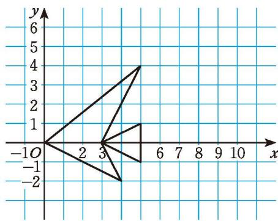

# 坐标系中水平平移对应点坐标变化探究

## 北师大版初中数学·八年级下册

图 3-7 中的 “鱼” 是将坐标为 $(0, 0)$ ， $(5, 4)$ ， $(3, 0)$ ， $(5, 1)$ ， $(5, -1)$ ， $(3, 0)$ ， $(4, -2)$ ， $(0, 0)$ 的点用线段依次连接而成的。将这条 “鱼” 向右平移 5 个单位长度。

图3-7

(1) 画出平移后的新 “鱼”。

(2) 在图中尽量多选取几组对应点, 并将它们的坐标填入下表。

<table><tr><td>原来的“鱼”</td><td>( , )</td><td>( , )</td><td>( , )</td><td>...</td></tr><tr><td>向右平移5个单位长度后的新“鱼”</td><td>( , )</td><td>( , )</td><td>( , )</td><td>...</td></tr></table>

(3) 你发现对应点的坐标之间有什么关系?

如果将原来的“鱼”向左平移4个单位长度呢？请你先想一想，再具体做一做。

