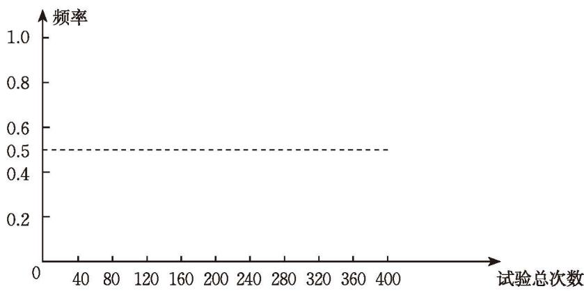

# 实验探究：掷质地均匀硬币与历史大量重复试验规律

## 北师大版初中数学·七年级下册

掷一枚质地均匀的硬币，硬币落下后，会出现两种情况（如图 3-4）：

正面朝上

正面朝下

图3-4
你认为正面朝上和正面朝下的可能性相同吗？
(1) 两人一组做 20 次掷硬币的试验, 并将数据记录在下表中。

<table><tr><td>试验总次数</td><td></td></tr><tr><td>正面朝上的次数</td><td></td></tr><tr><td>正面朝上的频率</td><td></td></tr><tr><td>正面朝下的次数</td><td></td></tr><tr><td>正面朝下的频率</td><td></td></tr></table>

(2) 累计全班同学的试验结果, 并将试验数据汇总填入下表。

<table><tr><td>试验总次数</td><td>40</td><td>80</td><td>120</td><td>160</td><td>200</td><td>240</td><td>280</td><td>320</td><td>360</td><td>400</td></tr><tr><td>正面朝上的次数</td><td></td><td></td><td></td><td></td><td></td><td></td><td></td><td></td><td></td><td></td></tr><tr><td>正面朝上的频率</td><td></td><td></td><td></td><td></td><td></td><td></td><td></td><td></td><td></td><td></td></tr><tr><td>正面朝下的次数</td><td></td><td></td><td></td><td></td><td></td><td></td><td></td><td></td><td></td><td></td></tr><tr><td>正面朝下的频率</td><td></td><td></td><td></td><td></td><td></td><td></td><td></td><td></td><td></td><td></td></tr></table>

利用数学软件也可以模拟掷硬币试验。

(3) 根据表格, 完成图 3-5 的折线统计图。

图3-5

(4) 观察图 3-5 的折线统计图, 你发现了什么规律?
(5) 下表列出了历史上一些数学家所做的掷硬币试验的数据:

<table><tr><td>试验者</td><td>试验总次数n</td><td>正面朝上的次数m</td><td>正面朝上的频率 $\frac{m}{n}$ </td></tr><tr><td>布丰</td><td>4040</td><td>2048</td><td>0.5069</td></tr><tr><td>德·摩根</td><td>4092</td><td>2048</td><td>0.5005</td></tr><tr><td>费勒</td><td>10000</td><td>4979</td><td>0.4979</td></tr><tr><td>皮尔逊</td><td>12000</td><td>6019</td><td>0.5016</td></tr><tr><td>皮尔逊</td><td>24000</td><td>12012</td><td>0.5005</td></tr><tr><td>维尼</td><td>30000</td><td>14994</td><td>0.4998</td></tr><tr><td>罗曼诺夫斯基</td><td>80640</td><td>39699</td><td>0.4923</td></tr></table>

表中的数据支持你发现的规律吗?

