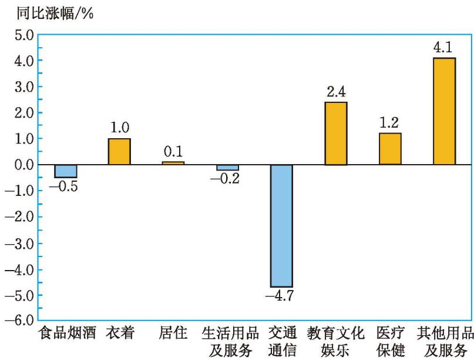

# 尝试·交流：气温、海拔与同比涨幅中的正负数意义

## 北师大版初中数学·七年级上册

> [!question] 尝试·交流
> (1) 下表是 2023 年 1 月 1 日四个城市的气温情况。你能说出表中各数的实际意义吗?
>
> <table><tr><td>城市</td><td>北京</td><td>昆明</td><td>西安</td><td>哈尔滨</td></tr><tr><td>气温</td><td>-7°C~5°C</td><td>7°C~13°C</td><td>-2°C~2°C</td><td>-19°C~-14°C</td></tr></table>
>
> (2) 珠穆朗玛峰的海拔大约是 $8848.86 \mathrm{~m}$ , 吐鲁番盆地最低处的海拔大约是 $-154.31 \mathrm{~m}$ 。 $8848.86 \mathrm{~m}, -154.31 \mathrm{~m}$ 的实际意义分别是什么?
>
> (3) 图 2-2 展示了 2023 年 7 月我国居民消费价格分类别同比涨幅情况。请你说一说 $-0.5\%$ , $2.4\%$ 等数的实际意义, 并与同伴进行交流。
>
> 
> 图2-2
>

