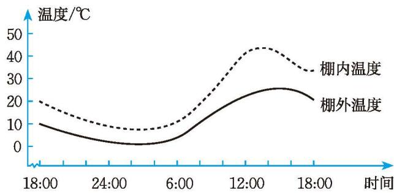

> [!question] 尝试·交流
> 1. 某海域海水的压强 $p$ (单位: $\mathrm{Pa}$ ) 与水深 $h$ (单位: $\mathrm{m}$ ) 之间的关系满足: $p = 9.8 \rho h$ (其中 $\rho$ 为海水的密度, 通常为 $1.03 \times 10^{3} \mathrm{~kg} / \mathrm{m}^{3}$ )。
>
> (1) 这个情境中有哪些量?
>
> (2) 随着水深 $h$ 的变化, 其他量会发生变化吗?
>
> 2. 图 6-1 反映了一个蔬菜大棚某日 18:00 到次日 18:00 棚内温度和棚外温度的变化情况。
>
> 
> 图6-1
>
> (1) 这个情境中有哪些量?
>
> (2) 你能描述这个蔬菜大棚棚内温度随时间的变化而变化的情况吗? 棚外温度呢?
>
> (3) 你还有哪些发现？与同伴进行交流。
