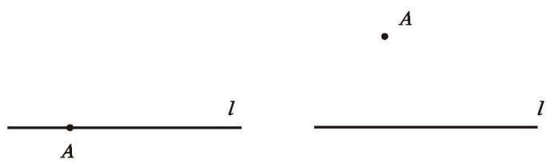
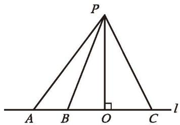

# 尝试·交流：过一点画垂线唯一性与垂线段长短比较

## 北师大版初中数学·七年级下册

> [!question] 尝试·交流
> (1)如图2-10, 点 $A$ 在直线 $l$ 上, 你能用三角尺过点 $A$ 画直线 $l$ 的垂线吗? 你能画出多少条? 如果点 $A$ 在直线 $l$ 外呢? 你是怎样做的? 与同伴进行交流。
>
> 
>
> l
>
> 图2-10
>
> (2)如图2-11, 点 $P$ 是直线 $l$ 外一点, $PO \perp l$ , 点 $O$ 是垂足。点 $A, B, C$ 在直线 $l$ 上, 比较线段 $PO, PA, PB, PC$ 的长短, 你发现了什么?
>
> 
> 图2-11
>

