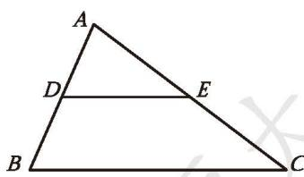

# 尝试·思考：代数式 n²-n+11 质数归纳与三角形中位线猜想的可靠性检验

## 北师大版初中数学·八年级上册

> [!question] 尝试·思考
> (1) 对于自然数 $n$ , 代数式 $n^{2} - n + 11$ 的值是质数吗? 取 $n = 0, 1, 2, 3, 4, 5$ 试一试, 你能否由此得到结论 “对于所有自然数 $n$ , $n^{2} - n + 11$ 的值都是质数”?
>
> (2) 如图 7-4, 在 $\triangle ABC$ 中, 点 $D$ , $E$ 分别是 $AB$ , $AC$ 的中点, 连接 $DE$ 。 $DE$ 与 $BC$ 有怎样的位置关系和数量关系? 请你先猜一猜, 再设法检验你的猜想。你能肯定你的结论对所有的 $\triangle ABC$ 都成立吗?
>
> 
> 图7-4
>

