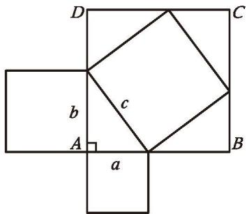
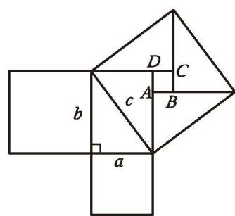

> [!question] 尝试·思考
> 为了计算图 1-4 中大正方形的面积，小明对这个大正方形适当割补后，分别得到图 1-5、图 1-6。
>
> 
> 图1-5
>
> 
> 图1-6
>
> (1) 将所有三角形的面积和正方形的面积用含 $a, b, c$ 的式子表示出来。
>
> (2) 图 1-5、图 1-6 中正方形 $ABCD$ 的面积分别是多少? 你有哪些表示方式?
>
> (3)你能分别利用图 1-5、图 1-6 验证勾股定理吗?
