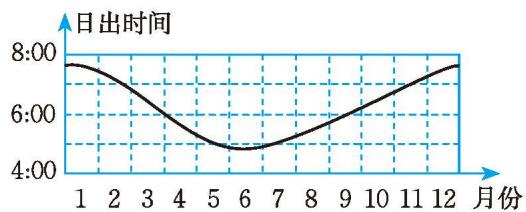
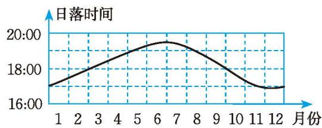

# 尝试·思考：双图象对比分析一年日出日落时间规律

## 北师大版初中数学·七年级下册

> [!question] 尝试·思考
> 图 6-7 呈现了某年某地日出时间、日落时间的情况。观察图象，回答下列问题：
>
> (1) 你能描述这一年此地日出时间和日落时间的变化情况吗?
>
> (2) 这一年日出时间最早大约是什么时候？最晚呢？日落时间呢？
>
> 
>
> 
> 图6-7
>

