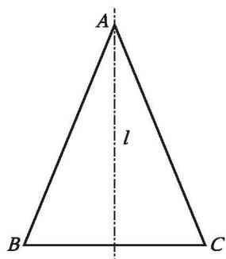

# 尝试·思考：在等腰三角形中画轴对称对应元素

## 北师大版初中数学·七年级下册

> [!question] 尝试·思考
> 如图 5-11, $\triangle ABC$ 是一个等腰三角形, 直线 $l$ 是它的对称轴。请在 $\triangle ABC$ 中画出以直线 $l$ 为对称轴的一组对应点、一组对应线段、一组对应角, 你能发现哪些相等的线段、相等的角, 以及形状、大小完全相同的图形?
>
> 
> 图5-11
>

