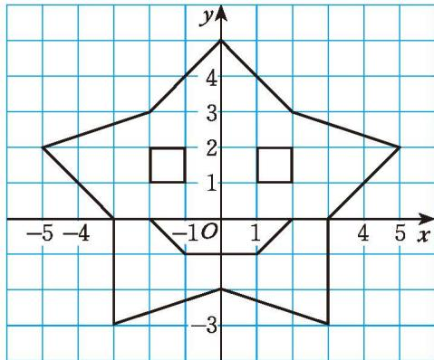

> [!question] 尝试·思考
> 图 3-12 中有一个 “笑脸”。
>
> (1) 在 “笑脸” 上找出几个位于第一象限的点, 指出它们的坐标, 说说这些点的坐标有什么特点。
>
> (2) 在其他象限内分别找几个点, 看看其他各个象限内的点的坐标有什么特点。
>
> (3) 不描出点, 分别判断 $A(1, 2)$ , $B(-1, -3)$ , $C(2, -1)$ , $D(-3, 4)$ 所在的象限。
>
> 
> 图3-12
>
