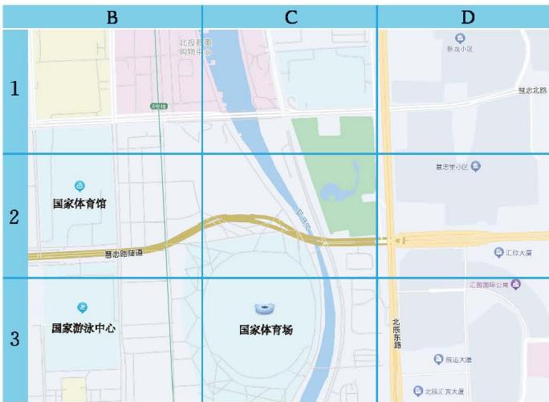

> [!question] 尝试·思考
> (1) 2020 年 7 月 23 日, 我国首次火星探测任务探测器 “天问一号” 在中国文昌航天发射场发射升空。中国文昌航天发射场位于北纬 $19^{\circ}$ 、东经 $110^{\circ}$ 左右。你能在地图上找到中国文昌航天发射场的大致位置吗? 请试一试。
>
> (2) 图 3-2 是北京奥林匹克公园简图的一部分, 如何向同伴介绍 “国家体育馆” 所在的区域? “国家体育场” 呢?
>
> 
> 图3-2
>
