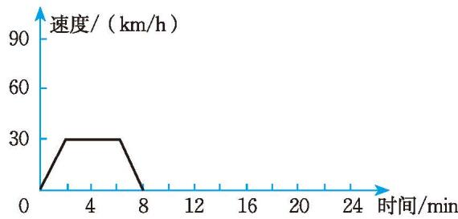

> [!question] 尝试·思考
> 在上面的情境中, 假设这辆汽车出发后 $8 \mathrm{~min}$ 到 $12 \mathrm{~min}$ 静止不动, 然后用 $6 \mathrm{~min}$ 加速到 $90 \mathrm{~km} / \mathrm{h}$ , 再用 $6 \mathrm{~min}$ 减速到静止。你能在图 6-10 中画图大致反映这辆汽车的速度随时间的变化而变化的情况吗?
>
> 
> 图6-10
>
