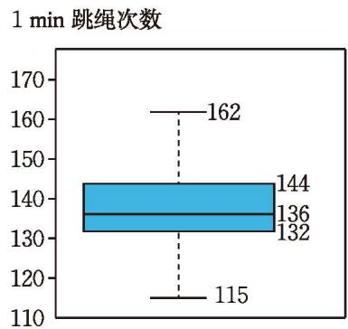

> [!question] 尝试·思考
> 老师记录了全班 40 名学生 1 min 跳绳的次数:
>
> <table><tr><td>132</td><td>136</td><td>144</td><td>162</td><td>144</td><td>115</td><td>132</td><td>136</td><td>123</td><td>144</td></tr><tr><td>136</td><td>132</td><td>132</td><td>159</td><td>136</td><td>144</td><td>129</td><td>136</td><td>139</td><td>153</td></tr><tr><td>123</td><td>133</td><td>144</td><td>137</td><td>152</td><td>138</td><td>136</td><td>129</td><td>129</td><td>134</td></tr><tr><td>138</td><td>149</td><td>125</td><td>128</td><td>128</td><td>133</td><td>138</td><td>134</td><td>146</td><td>148</td></tr></table>
>
> (1) 求全班学生 $1 \mathrm{~min}$ 跳绳次数的最小值、下四分位数、中位数、上四分位数和最大值。
>
> (2) 老师绘制了如图 6-7 所示的统计图。你能读懂这个统计图吗? 图中出现了 5 条横线, 分别对应 5 个数据, 它们是怎样的数据? 你认为这个统计图是如何画出的?
>
> 
> 图6-7
>
> (3) 根据图 6-7, 中间的 “箱子” 被 136 分成了两部分, 其中 “下半截箱子” 比较短, 这说明什么?
>
> 
>
