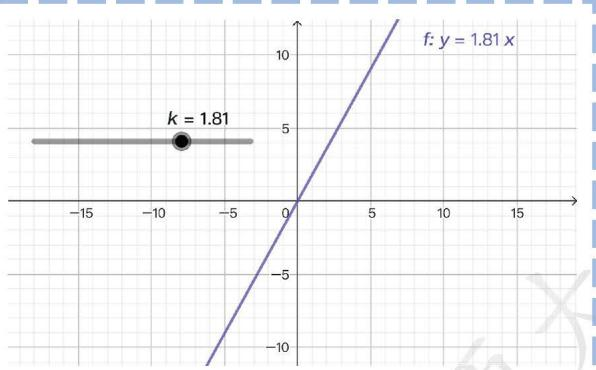

> [!question] 尝试·思考
> (1) 在同一平面直角坐标系中画出正比例函数 $y = x,y = {3x},y =  - \frac{1}{2}x$ 和 $y =  - {4x}$ 的图象。
>
> (2) 上述四个函数中, 随着 $x$ 值的增大, $y$ 的值分别如何变化? 相应图象上的点的变化趋势如何?
>
> 也可以利用数学软件绘制正比例函数的图象（如图4-6），并通过改变k的值发现k对函数图象的影响。
>
> 
> 图4-6
>
