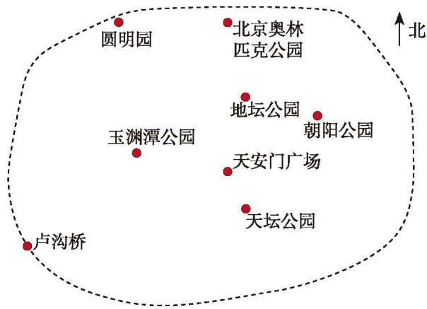
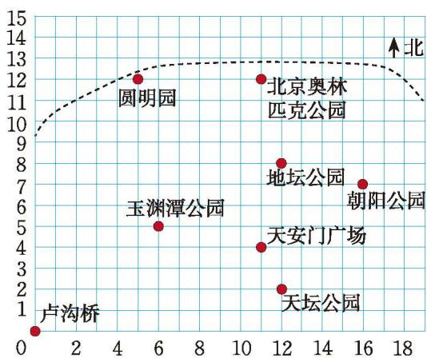
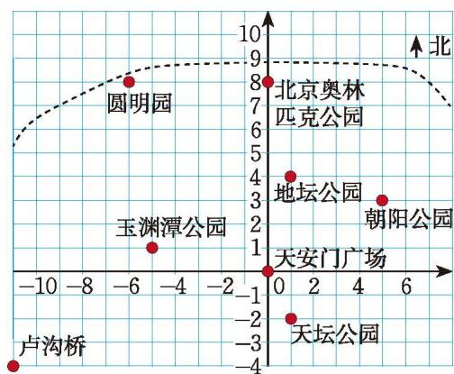

# 尝试·思考：用数对建立北京景点位置网格与坐标表示探究

## 北师大版初中数学·八年级上册

> [!question] 尝试·思考
> (1) 如图 3-5, 小亮在景点图上画上了方格, 标上数字, 并用 (0, 0) 表示卢沟桥的位置, 用 (11, 4) 表示天安门广场的位置, 那么北京
>
> 
> 图3-4
>
> 奥林匹克公园的位置应如何表示？（5，12）表示哪个景点的位置？（6，5）呢？
>
> 
> 图3-5
>
> 
>

