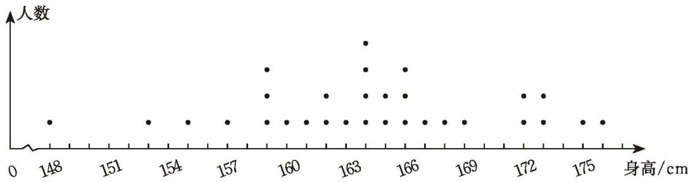
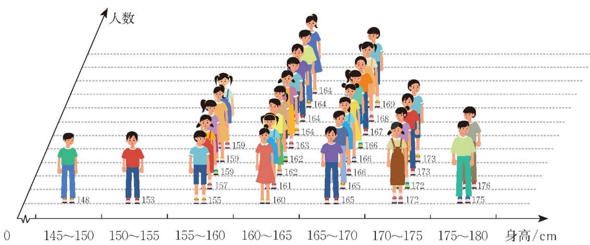

> [!question] 尝试·思考
> 对于表 6-1, 如果关注全班学生的身高, 那么你能解决下列问题吗?
>
> (1) 全班学生最高身高是多少? 最矮呢? 出现次数最多的身高数据是哪个? 全班学生身高的平均数是多少?
>
> (2) 你能用适当的统计图表示全班学生的身高情况吗? 在你画的统计图中能找出 (1) 中要求的各个数值吗?
>
> (3) 图 6-1 和图 6-2 $^{①}$ 都是根据表 6-1 中的身高数据画出的统计图。你能从这两幅图中得到哪些信息？这两幅图与你画的统计图有什么区别和联系？
>
> 
> 图6-1
>
> 
> 图6-2
>
