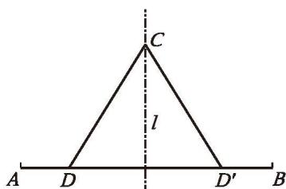

> [!question] 尝试·思考
> 如图 5-13, 直线 $l$ 是线段 $AB$ 的垂直平分线, 点 $C$ 是 $l$ 上的任意一点。在线段 $AB$ 上画出以直线 $l$ 为对称轴的一组对应点 $D$ 和 $D'$ , 连接 $CD$ 和 $CD'$ 。
>
> (1) 你认为线段 $CD$ 和 $CD'$ 之间有什么关系? 说说你的理由。
>
> 
> 图5-13
>
> (2) 特别地, 当点 $D$ 与点 $A$ 重合时, 点 ${D}^{\prime }$ 位于
>
> 什么位置? 此时, 线段 $CD$ 和 $CD'$ 之间还有 (1) 中的关系吗? 由此你能得到什么结论?
