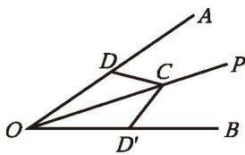
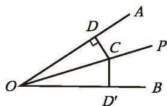

# 尝试·思考：角平分线上点到角两边距离关系探究

## 北师大版初中数学·七年级下册

> [!question] 尝试·思考
> 如图 5-19, OP 是 $\angle AOB$ 的平分线, 点 $C$ 是 $OP$ 上的任意一点。在 $\angle AOB$ 的两边上画出以 $OP$ 所在直线为对称轴的一组对应点 $D$ 和 $D'$ , 连接 $CD$ 和 $CD'$ 。
>
> (1) 你认为线段 $CD$ 和 $CD'$ 之间有什么关系? 说说你的理由。
>
> 
> 图5-19
>
> 
> 图5-20
>
> (2)特别地, 当 $CD \perp OA$ 时 (如图5-20), $CD'$ 与 $OB$ 有怎样的位置关系?为什么? 此时, 线段 $CD$ 和 $CD'$ 之间还有 (1) 中的关系吗? 由此你能得到什么结论?

