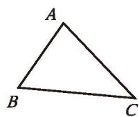

# 已知旋转中心与一对对应点作旋转图形探究

## 北师大版初中数学·八年级下册

> [!question] 操作·交流
> 如图 3-18, $\bigtriangleup  {ABC}$ 绕点 $O$ 按逆时针方向旋转后,顶点 $A$ 旋转到了点 $D$ 。
>
> (1) 指出这一旋转的旋转角。
>
> (2) 画出旋转后的三角形。
>
> (3) 与同伴交流你的画法, 你们的画法都一样吗? 还有其他画法吗?
>
> 
> 图3-18
>

