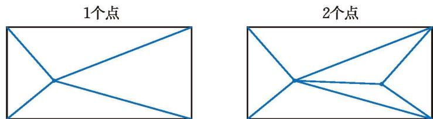

# 归纳策略探究问题：低多边形风格长方形内分三角形（理解·计划）

## 北师大版初中数学·七年级上册

问题 “低多边形风格” 是一种数字艺术设计风格。它将整个区域分割为若干三角形，通过把相邻三角形涂上不同颜色，产生立体及光影的效果，随着三角形数量增加，效果更为斑斓绚丽（如图 3-9）。

图3-9

将长方形区域分割成三角形的过程是：在长方形内取一定数量的点，连同长方形的4个顶点，逐步连接这些点，保证所有连线不再相交产生新的点，直到长方形内所有区域都变成三角形。

如图 3-10，当长方形内有 1 个点时，可分得 4 个三角形；当长方形内有 2 个点时，可分得 6 个三角形（不计被分割的三角形）。

图3-10

当长方形内有 35 个点时，可分得多少个三角形？

(1) 先动手画一画, 感受分割得到三角形的过程。

(2) 已知条件是什么? 目标是什么?

(1) 直接研究 “长方形内有 35 个点” 的情形, 你遇到了什么困难?

(2)哪些情形容易研究?从中你能发现什么规律?

(3) 你发现的规律正确吗？你能给出合理的解释吗？

写出你的解决方案，并说明其中的道理。

