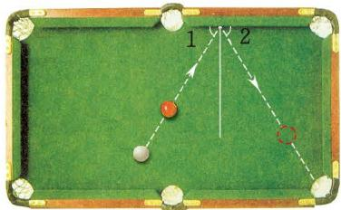
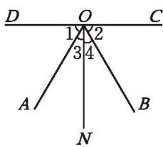

> [!question] 思考·交流
> 如图 2-3，打台球时，选择适当的方向用白球击打红球，反弹后的红球会直接入袋，此时 $\angle1=\angle2$ 。
>
> 
> 图2-3
>
> 
> 图2-4
>
> 将图 2-3 简化为图 2-4，ON 与 DC 相交所成的 $\angle DON$ 和 $\angle CON$ 都等于 $90^{\circ}$ ，且 $\angle 1 = \angle 2$ 。
>
> (1) 请在图 2-4 中找出互为补角和互为余角的角，并说说你的理由。
>
> (2) $\angle 3$ 与 $\angle 4$ 的大小有什么关系? $\angle AOC$ 与 $\angle BOD$ 呢? 你能说明理由吗? 与同伴进行交流。
