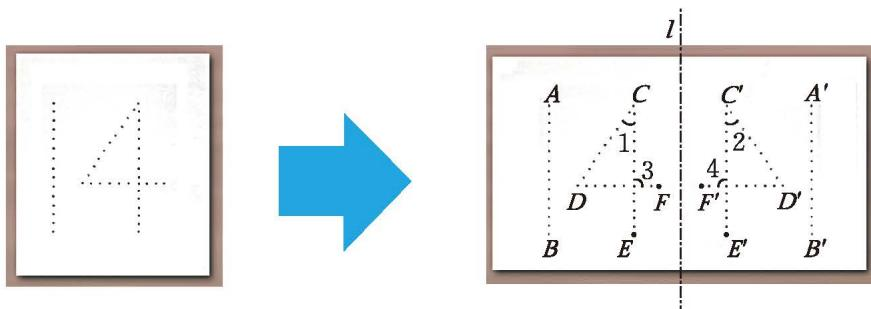

# 思考·交流：对折扎纸探索成轴对称性质

## 北师大版初中数学·七年级下册

> [!question] 思考·交流
> 如图 5- 5, 将一张长方形纸对折, 然后用笔尖扎出数字 “14”, 再将纸打开后铺平。
>
> 
> 图5-5
>
> 在铺平的图中:
>
> (1) 两个 “14” 之间有什么关系?
>
> (2) 对应线段之间有什么关系? 对应角之间有什么关系? 连接对应点的线段与对称轴 $l$ 之间有什么关系? 请举例说明, 并与同伴进行交流。

