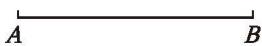

# 思考·交流：尺规作线段垂直平分线的作图思路分析

## 北师大版初中数学·七年级下册

> [!question] 思考·交流
> 如图 5-14, 已知线段 $AB$ , 如何作出它的垂直平分线? 假设线段 $AB$ 的垂直平分线已作出, 请回答下列问题:
>
> 
> 图5-14
>
> (1) 这条直线有什么特征?
>
> (2) 如何确定这条直线上的两个点? 用三角尺、量角器、圆规等工具试一试。如果只用尺规呢? 与同伴进行交流。
>
> 需要确定的点是线段对称轴上的点，因此应当从线段两端进行“对称”的操作。

