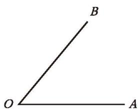

> [!question] 思考·交流
> 如图 5-21, 已知 $\angle AOB$ , 如何作出它的平分线?
>
> 
> 图5-21
>
> 
>
> 假设 $\angle AOB$ 的平分线已作出，请回答下列问题：
>
> (1) 这条射线有什么特征?
>
> 需要确定的点是角的对称轴上的点，因此应当从角两边进行“对称”的操作。
>
> (2) 如何确定这条射线上除端点之外的一
>
> 个点？用三角尺、量角器、圆规等工具试一试。如果只用尺规呢？与同伴进行交流。
