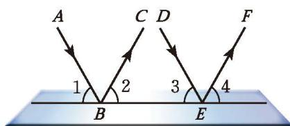

> [!question] 思考·交流
> 如图 2-29，一束平行光线 AB 与 DE 射向一个水平镜面后被反射，此时 $\angle1 = \angle2$ ， $\angle3 = \angle4$ 。
>
> 
>
> (1) $\angle 1$ 与 $\angle 3$ 的大小有什么关系？ $\angle 2$ 与 $\angle 4$ 呢？
>
> 图2-29
>
> (2) 反射光线 $BC$ 与 $EF$ 也平行吗?
>
> 
>
> 我是这样思考的：
>
> (1) 由 $AB \parallel DE$ , 可以得到 $\angle 1 = \angle 3$ ;
>
> 由 $\angle 1 = \angle 2, \angle 3 = \angle 4$ ，可以得到 $\angle 2 = \angle 4$ 。
>
> (2) 由 $\angle 2 = \angle 4$ ，可以得到 $BC \parallel EF$ 。
>
> 你能说明小颖每一步的理由吗？
>
> 你是如何思考的？与同伴进行交流。
