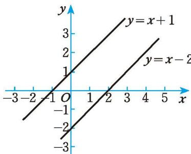

> [!question] 思考·交流
> 如图 5-5，在同一平面直角坐标系中，一次函数 $y = x + 1$ 与 y = x - 2 的图象有怎样的位置关系？方程组 $\left\{\begin{aligned}x-y=-1,\\ x-y=2\end{aligned}\right.$ 解的情况如何？你发现了什么？与同伴进行交流。
>
> 二元一次方程组的解对应着平面上两条直线的交点。
>
> 
> 图5-5
>
